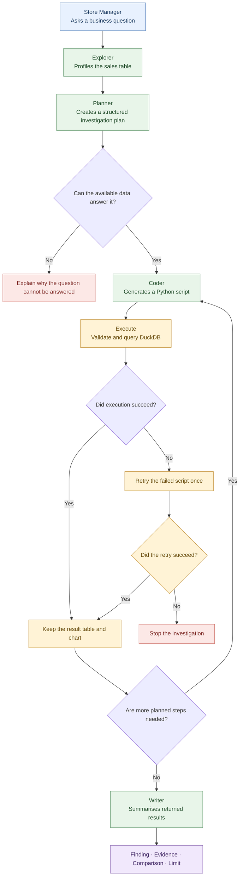

# Sales Check

**An AI-powered sales investigation agent for non-technical business users.**

Sales Check turns a plain-language business question into a short, multi-step investigation. It queries sales data in DuckDB, generates charts, and returns an initial explanation supported by numerical evidence.

Rather than waiting for the BI team to build a new dashboard, a store manager can use it to investigate a potential performance issue and identify where to look next.

> **Example question:** “Why is Kowloon down this week?”

Sales Check is designed for an initial investigation, not as a replacement for a governed BI report.

---

## 1. Business Problem

A store manager notices that sales performance in one region has dropped but does not have the technical skills to investigate the underlying data independently.

The usual process may require the manager to request additional reports from the BI team, creating a delay between identifying a problem and understanding it.

Sales Check addresses this gap by allowing the manager to:

- Ask business questions in natural language.
- Investigate performance across different regions and product categories.
- Compare the latest seven days with the preceding seven days.
- Receive charts, supporting figures, and an initial explanation.
- Identify what the available data can—and cannot—explain.

**Business objective:** Shorten the distance between identifying a sales problem and beginning an evidence-based investigation.

## 2. How It Works

The application follows a structured investigation workflow using LangGraph. Each step has a defined responsibility, helping separate question planning, code generation, data execution, and answer writing.

### Investigation lifecycle

| Stage | Responsibility |
|---|---|
| **Explorer** | Profiles the table, identifies columns and category values, and calculates the comparison windows. |
| **Planner** | Converts the question into a structured plan containing the purpose
