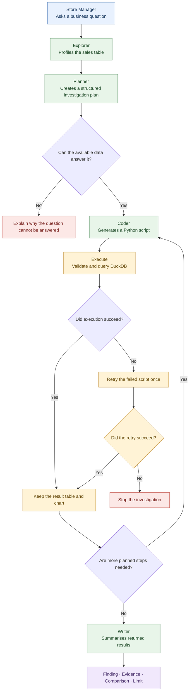

# Sales Check

**An AI-powered sales investigation agent for non-technical business users.**

Sales Check turns a plain-language business question into a short, multi-step investigation. It queries sales data in DuckDB, generates charts, and returns an initial explanation supported by numerical evidence.

Rather than waiting for the BI team to build a new dashboard, a store manager can use it to investigate a potential performance issue and identify where to look next.

> **Example question:** “Why is Kowloon down this week?”

Sales Check is designed for an initial investigation, not as a replacement for a governed BI report.

---

## 1. Business Problem

A store manager notices that sales performance in one region has dropped but does not have the technical skills to investigate the underlying data independently.

The usual process may require the manager to request additional reports from the BI team, creating a delay between identifying a problem and understanding it.

Sales Check addresses this gap by allowing the manager to:

- Ask business questions in natural language.
- Investigate performance across different regions and product categories.
- Compare the latest seven days with the preceding seven days.
- Receive charts, supporting figures, and an initial explanation.
- Identify what the available data can—and cannot—explain.

**Business objective:** Shorten the distance between identifying a sales problem and beginning an evidence-based investigation.

## 2. How It Works

The application follows a structured investigation workflow using LangGraph. Each step has a defined responsibility, helping separate question planning, code generation, data execution, and answer writing.



### Investigation lifecycle

| Stage | Responsibility |
|---|---|
| **Explorer** | Profiles the table, identifies columns and category values, and calculates the comparison windows. |
| **Planner** | Converts the question into a structured plan containing the purpose, columns, chart type, and step instructions. |
| **Coder** | Uses DeepSeek to generate one Python script for the current investigation step. |
| **Execute** | Validates and runs the script against DuckDB, retaining the result table and chart. |
| **Iterate** | Continues to the next planned step, with a maximum of three steps and one retry per failed script. |
| **Writer** | Produces an evidence-backed answer using the returned result tables rather than the raw source data. |

A simple ranking question may require only one step. A question asking *why* performance has declined may require two or three steps to examine the weakest region or category.

Questions requiring unavailable information, such as staff levels or weather, are refused rather than investigated using unsupported assumptions.

---

## 3. Sample Dataset

The application reads a single DuckDB table named `sales`. There is no file-upload interface.

| Property | Details |
|---|---|
| **Business** | Lane & Co. |
| **Dataset size** | 1,416 rows |
| **Date range** | 1 July 2026 – 26 October 2026 |
| **Geographic coverage** | Kowloon, Hong Kong Island, New Territories |
| **Product categories** | Beverage, Snacks, Household, Fresh |
| **Data grain** | One row per day, region, and category |

### Data schema

| Column | Description |
|---|---|
| `date` | Sales record date |
| `year`, `month`, `weekday` | Date attributes |
| `region` | Sales region |
| `category` | Product category |
| `sales` | Sales amount |
| `cost` | Cost amount |
| `units` | Units sold |
| `orders` | Number of orders |

### Data preparation

The CSV file is the source dataset:

```text
data/sample_sales.csv
```

Build the DuckDB database with:

```bash
python build_db.py
```

This loads the CSV data into:

```text
data/sales.duckdb
```

Rebuild the database only when the source CSV changes.

### Date comparison logic

The application interprets **“this week”** as a rolling seven-day period, rather than a calendar week.

- **Current period:** The latest date in the table and the six preceding days.
- **Previous period:** The seven days immediately before the current period.

This keeps the comparison aligned with the latest data available in the database.

---

## 4. Technical Design

### Technology stack

| Technology | Purpose |
|---|---|
| **Python** | Investigation logic and execution orchestration |
| **LangGraph** | Controls the investigation workflow |
| **DeepSeek API** | Generates investigation plans and Python scripts |
| **Pydantic** | Validates structured planner output |
| **DuckDB** | Executes analytical queries against the sales table |
| **Pandas** | Handles tabular results |
| **Plotly** | Generates charts |
| **Streamlit** | Provides the user interface |

### Key design decisions

**1. Separate planning from execution**

The Planner decides what to investigate, while the Coder generates the script for each step. This makes the investigation process easier to inspect than a single unrestricted prompt.

**2. Keep data calculations in SQL**

The model generates code, but DuckDB executes the analytical queries. The model does not directly invent the numerical results returned by those queries.

**3. Restrict database access**

Generated scripts are restricted to read-only queries against the `sales` table. The application validates the script before execution and runs it in a temporary folder.

**4. Use evidence-backed answers**

The Writer receives the result tables rather than the raw source rows. Its answer follows four headings:

- **Finding** — What changed or stands out?
- **Evidence** — Which figures support the finding?
- **Comparison** — How does performance compare with the previous period?
- **Limit** — What cannot be concluded from the available data?

**5. Apply a defined investigation boundary**

The Planner can propose between one and three steps. Failed scripts are retried once, limiting the amount of work performed when generated code does not execute successfully.

**6. Use a defined profit-margin calculation**

Profit margin is calculated as:

\[
\text{Profit Margin} =
\frac{\sum(\text{sales}-\text{cost})}{\sum(\text{sales})}
\]

This is preferable to taking the average of individual row-level profit-margin ratios when calculating an overall margin.

The model chooses the comparison and the Python execution layer checks the actual query and its execution boundary.

---

## 5. Business Value

| Capability | Practical value |
|---|---|
| Natural-language questions | Reduces dependence on technical SQL knowledge and dashboard filters. |
| Multi-step investigation | Allows the agent to move from a broad performance concern to a more specific region or category. |
| SQL-based calculations | Keeps numerical calculations grounded in the database results. |
| Charts and result tables | Makes findings easier to inspect and verify. |
| Evidence-backed summaries | Connects the written answer to the figures that support it. |
| Dynamic date windows | Keeps the comparison aligned with the latest date in the dataset. |

### Why use an agent workflow?

A conventional text-to-SQL tool may answer a question with one query. Sales Check is designed to support a short investigation: it plans the steps, executes each step, retains the intermediate results, and uses those results to produce an initial explanation.

The objective is not to replace an analyst. It is to help a business user arrive at a more informed first question before escalating the issue to the BI team.

---

## 6. Limitations and Assumptions

This is a controlled portfolio demonstration, not a production-ready analytics platform.

- **Single data source:** The application uses one DuckDB table and does not connect to an enterprise warehouse.
- **Synthetic data:** The Lane & Co. dataset is synthetic. The Kowloon beverage sales decline is deliberately planted to demonstrate the investigation workflow.
- **Limited investigation depth:** The Planner can generate at most three steps. Each failed script is retried once, after which the investigation stops.
- **No certified metric catalog:** The application does not use a governed business-metric definition layer.
- **Rolling seven-day comparison:** “This week” means the latest seven days in the file, not the company's official business calendar week.
- **Potential interpretation errors:** Although the Writer is instructed to cite returned numbers, it may still phrase a comparison or conclusion poorly.
- **Limited explanatory variables:** The application cannot establish causes involving rent, staff levels, weather, or promotional spending because these variables are absent from the dataset.
- **No persistent session history:** Results are not saved. Refreshing the page clears the current result.

These limitations mean that the output should be treated as an initial diagnostic hypothesis, not a definitive explanation of the business problem.

---

## 7. Project Scope

Sales Check demonstrates a practical combination of business analysis, data querying, and LLM-based workflow orchestration.

Its main focus is the path from a business question to a constrained investigation and an evidence-backed first answer—not simply building a chatbot that can generate SQL.

**Core workflow:** Natural-language question → Investigation plan → Read-only query execution → Charts and result tables → Evidence-backed answer.

